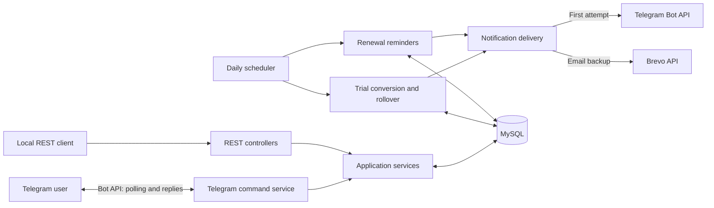

# Subtracker Bot

A Telegram bot for keeping track of subscriptions, upcoming renewals, free trials, and monthly spending. Notifications go to Telegram first, with a Brevo email backup when Telegram delivery fails.

**Java 21 · Spring Boot 4.1 · MySQL · Spring Data JPA · Telegram Bot API · Brevo**

[Watch the live Telegram demo on YouTube](https://youtu.be/QYdJOTTzsFc)

The demo shows how to add subscriptions, check monthly spending, track a free trial, and change reminder settings directly in Telegram.

## Features

- Create monthly or yearly subscriptions with multi-word names and optional free trials.
- View subscription details and ownership-checked Telegram actions to keep, cancel, or delete them.
- Receive one advance renewal reminder per billing cycle, using each user's reminder window.
- Automatically mark expired trials ACTIVE and advance renewal dates, with a conversion notice.
- Catch up on missed billing cycles and retry failed trial-conversion notices.
- Calculate monthly spending by currency, with yearly plans normalized and trials listed separately.
- Set reminder days, a default currency for new subscriptions, and an optional backup email.
- Send readable Telegram messages and HTML emails with a plain-text alternative and a link to the bot.
- Persist delivery history and guard against duplicate log rows for the same subscription, notification type, and renewal date.

## Example output

```text
🔔 Renewal in 3 days

Netflix Premium · #25
Amount: LKR 1,500.00 / month
Renewal: 19 Nov 2026

Here's your heads-up before the next payment.

/keep 25 - keep tracking
/cancel 25 - stop reminders

To stop actual charges, cancel with the provider too.
```

The example dates and IDs are illustrative. Use your own subscription dates and the IDs returned by `/list`.

## Architecture



The application calls Telegram and Brevo through Spring's `RestClient`, without a Telegram SDK. JPA repositories persist users, subscriptions, and reminder logs. HTTP controllers return DTOs in a consistent `ApiResponse` wrapper.

| Entity | Purpose |
| --- | --- |
| `User` | Telegram chat ID, reminder window, default currency, optional email |
| `Subscription` | Owner, amount, currency, billing cycle, status, renewal date, pending trial notice |
| `ReminderLog` | Notification type, channel, renewal date, and time of successful acceptance |

## Demo deployment

The Spring Boot JAR ran on Azure App Service (Linux, Java 21). Azure Database for MySQL Flexible Server stored the application data, and Azure Key Vault held the database password and integration credentials.

## Run locally

### Prerequisites

- JDK 21, with `JAVA_HOME` configured.
- MySQL 8 running locally, or another reachable MySQL instance.
- A Telegram bot created through BotFather and a bot token.
- Optional: a Brevo API key with sending access and a verified sender for email backup.

The Maven Wrapper is included, so a separate Maven installation is not required. The first build downloads dependencies.

### Clone and configure

```powershell
git clone https://github.com/dhananjaya-kularatne/subtracker-bot.git
cd subtracker-bot\backend
```

The committed [`application.properties`](backend/src/main/resources/application.properties) contains environment-variable references, not passwords or API keys. Its local database defaults are `localhost:3306`, database `subtracker_db`, and username `root`. Hibernate creates or updates the development schema at startup; the database account needs the corresponding permissions.

Set the required credentials in the terminal you will use to start the app. In PowerShell, hidden prompts avoid putting secret values in command history:

```powershell
$dbSecret = Read-Host 'MySQL password' -AsSecureString
$env:DB_PASSWORD = [System.Net.NetworkCredential]::new('', $dbSecret).Password
Remove-Variable dbSecret

$telegramSecret = Read-Host 'Telegram bot token' -AsSecureString
$env:TELEGRAM_BOT_TOKEN = [System.Net.NetworkCredential]::new('', $telegramSecret).Password
Remove-Variable telegramSecret

$env:TELEGRAM_BOT_USERNAME = 'your_bot_username_without_at_sign'
```

If needed, override the local connection or server port using Spring environment variables:

```powershell
$env:SPRING_DATASOURCE_URL = 'jdbc:mysql://localhost:3306/subtracker_db?createDatabaseIfNotExist=true'
$env:SPRING_DATASOURCE_USERNAME = 'root'
$env:SERVER_PORT = '8080'
```

### Start the backend

```powershell
.\mvnw.cmd spring-boot:run
```

On Linux or macOS, run `bash mvnw spring-boot:run` from `backend/` after setting the same environment variables in your shell.

Open your bot in Telegram and send `/start` or `/help`. Send one command per message. Only run one polling instance for a bot token at a time, and do not register an active Telegram webhook while using long polling.

### Optional local properties file

[`backend/application.properties.example`](backend/application.properties.example) is an alternative template for developers who prefer a local profile:

```powershell
Copy-Item .\application.properties.example .\src\main\resources\application-local.properties
```

Edit the copied file, replace its placeholders, then run:

```powershell
.\mvnw.cmd spring-boot:run "-Dspring-boot.run.arguments=--spring.profiles.active=local"
```

The copied file is ignored by Git. The `.example` file is not loaded automatically. A `.env` file is also not loaded automatically.

## Configuration

| Environment variable | Required | Default or purpose |
| --- | --- | --- |
| `DB_PASSWORD` | Yes, unless overridden by a local profile | MySQL password |
| `TELEGRAM_BOT_TOKEN` | Yes, unless overridden by a local profile | BotFather token |
| `TELEGRAM_BOT_USERNAME` | Set for your own bot | Username used in email links |
| `SPRING_DATASOURCE_URL` | No | Local `subtracker_db` connection |
| `SPRING_DATASOURCE_USERNAME` | No | `root` |
| `SERVER_PORT` | No | `8080` |
| `REMINDER_CRON` | No | `0 0 9 * * *`, daily at 09:00 Asia/Colombo |
| `BREVO_ENABLED` | No | `false` |
| `BREVO_API_KEY` | If email is enabled | Brevo API key, not an SMTP key |
| `BREVO_SENDER_EMAIL` | If email is enabled | Sender verified in the Brevo account |
| `BREVO_SENDER_NAME` | No | `Subtracker Bot` |

New users start with a 3-day reminder window and LKR as their default currency. These defaults are applied in `UserService`.

Changing Windows environment variables does not update an already running terminal or application. Reopen the terminal or reload the saved variable, then restart the backend. Check key presence with `[bool]$env:BREVO_API_KEY`; do not print the key.

## Telegram commands

| Command | What it does |
| --- | --- |
| `/start` or `/help` | Show help and future-dated examples |
| `/add <name> <amount> <monthly\|yearly> <yyyy-MM-dd> [trial]` | Create a subscription; the date is the next renewal or trial-ending date |
| `/list` | Show subscriptions, statuses, and IDs |
| `/summary` | Show active monthly equivalents and separate totals per currency |
| `/keep <id>` | Acknowledge a reminder without changing status or date |
| `/cancel <id>` | Mark the subscription CANCELLED and stop reminders |
| `/delete <id>` | Permanently remove the subscription and its reminder logs |
| `/settings` | Show current preferences |
| `/settings reminder <1-30>` | Set the advance reminder window |
| `/settings currency <code>` | Set the default currency for new subscriptions, such as `LKR` or `USD` |
| `/settings email <address>` | Set a recipient for fallback emails |
| `/settings email off` | Remove the fallback email address |

`/cancel` only updates tracking. It does not cancel the subscription with its provider. `/keep` does not reactivate a cancelled subscription. Amounts entered for trials are the paid price after the trial.

## Email backup

1. Create a standard API key in [Brevo](https://developers.brevo.com/docs/api-key-authentication). If permissions are shown, allow **Transactional email** sending.
2. Verify a sender address and complete any account verification required by Brevo.
3. Set `BREVO_ENABLED=true`, `BREVO_API_KEY`, and `BREVO_SENDER_EMAIL` before starting the app.
4. Save your recipient in Telegram with `/settings email <address>`.

The sender and recipient are separate settings. For example, an app sender can email a user's personal inbox.

Telegram is always attempted first. If it fails, the app attempts email only when a recipient and working Brevo configuration are available. A log is saved after a successful Telegram send or after Brevo accepts the email request. Provider acceptance does not guarantee inbox delivery.

For a manual check, use the every-minute schedule, block the bot before the next run for a fresh due subscription, and inspect the inbox and `reminder_logs.channel`. A subscription already logged as delivered will not send again for the same renewal date.

## Scheduling and billing rules

- All scheduler dates use `Asia/Colombo`. The application must be running when the cron job is due.
- Trial conversion and overdue rollover run before advance reminders.
- Due trials become ACTIVE without confirmation. Failed conversion notices retain a pending date for retry.
- Monthly and yearly dates advance until the next renewal is after today. Java date arithmetic clamps month ends and leap days, so January 31 can become February 28 and then March 28.
- Advance reminders include ACTIVE and TRIAL subscriptions inside each user's window. CANCELLED subscriptions are excluded.
- Reminder logs use a unique `(subscription_id, type, renewal_date)` key. This guards log rows; it does not provide exactly-once message delivery across simultaneous instances or a crash after sending.
- Spending summaries include ACTIVE subscriptions only. Yearly prices are divided by 12 and rounded to two decimals using `HALF_UP`; totals sum the displayed equivalents. Currencies are never converted or combined.

To check reminders every minute locally:

```powershell
$env:REMINDER_CRON = '0 * * * * *'
.\mvnw.cmd spring-boot:run
```

Afterward, stop the backend, remove the override, and restart:

```powershell
Remove-Item Env:REMINDER_CRON
.\mvnw.cmd spring-boot:run
```

## REST API

These endpoints are for local development. They currently have no authentication. A chat ID is an identifier, not proof of ownership, and ID-only REST lookups and deletions are not ownership-protected. Do not expose them publicly as-is.

| Method | Path | Purpose |
| --- | --- | --- |
| POST | `/api/v1/subscriptions?telegramChatId=<chat-id>` | Create a subscription |
| GET | `/api/v1/subscriptions?telegramChatId=<chat-id>` | List a user's subscriptions |
| GET | `/api/v1/subscriptions/{id}` | Read a subscription |
| DELETE | `/api/v1/subscriptions/{id}` | Hard-delete a subscription and its logs |
| GET | `/api/v1/users/{id}` | Read a user |
| POST | `/api/v1/telegram/webhook` | Receive an update; webhook secret validation is not implemented |

Example JSON for subscription creation:

```json
{
  "name": "Netflix",
  "amount": 1500,
  "currency": "LKR",
  "billingCycle": "MONTHLY",
  "nextRenewalDate": "2030-12-15",
  "trial": true
}
```

Use `Content-Type: application/json`, your own chat ID, and the actual renewal or trial end date. Currency is optional and defaults to the user's currency. `trial` is optional and defaults to `false`; `isTrial` is accepted as an alias. There is no REST update endpoint yet.

## Tests and build

The suite currently contains **95 automated checks**, including unit tests, mocked HTTP-client tests, and MySQL-backed application and REST checks. External Telegram and Brevo clients are mocked in the application tests, and scheduled jobs and polling are disabled there.

Run the unit and mocked HTTP tests without MySQL or provider credentials:

```powershell
cd backend
.\mvnw.cmd "-Dtest=*Tests,!SubtrackerBotApplicationTests" test
```

For the full suite, use a disposable local test database and a valid database password. A dummy Telegram token is sufficient because the polling client is mocked:

```powershell
$env:SPRING_DATASOURCE_URL = 'jdbc:mysql://localhost:3306/subtracker_test?createDatabaseIfNotExist=true'
$env:TELEGRAM_BOT_TOKEN = 'test-token-not-used'
.\mvnw.cmd verify
```

Application tests create and clean up temporary test records. Do not point them at a production database. Remove the test database override and restore your real bot token before running the application again.

The packaged application is written to `backend/target/subtracker-bot-0.0.1-SNAPSHOT.jar`.

## Project layout

```text
backend/
  pom.xml
  application.properties.example
  src/main/java/com/subtracker/bot/
    config/        HTTP clients, credentials, and Colombo clock
    controller/    Local REST and Telegram webhook routes
    dto/           Request and response objects
    exception/     Consistent HTTP errors
    model/         JPA entities and enums
    repository/    Persistence queries
    service/       Commands, scheduling, rollover, summaries, delivery
  src/main/resources/
    application.properties
    templates/notification-email.html
  src/test/java/com/subtracker/bot/
```

## Current limits and next steps

This is a working local backend project, not a production deployment. The next steps are authentication and REST ownership enforcement, webhook verification and selectable update transport, distributed notification coordination, versioned database migrations instead of `ddl-auto=update`, and deployment configuration.

Long polling currently starts automatically. The `/health` endpoint, provider subscription cancellation, exchange-rate conversion, and editing existing subscriptions are not implemented. Email backup depends on the sender configuration, provider permissions, and delivery status.

Never commit real tokens, passwords, private configuration files, inbox screenshots, or logs containing credentials. The repository includes ignore rules for local profiles and `.env` files; these are a convenience, not a substitute for checking what is staged.
